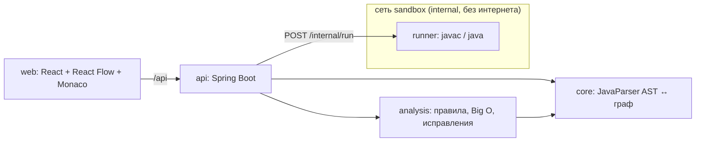

# Архитектура

## Поток данных

1. **Загрузка.** `POST /api/projects` → `JavaProjectParser` строит AST (с сохранением форматирования). Это версия 1 —
   эталон поведения.
2. **Граф.** `GraphBuilder` проецирует AST в граф (`contracts/graph.schema.json`): обзор (классы, методы, вызовы)
   или блок-схема метода. Каждый узел хранит `astId` и диапазон строк — отсюда двусторонняя подсветка.
3. **Правка.** Код в редакторе → `PUT /source` → перепарсинг. Правка на графе → `POST /graph/ops` → операция над AST →
   `CodeGenerator` печатает код → новая версия. Источник истины всегда AST, поэтому код и граф не расходятся.
4. **Диагностика.** `Analyzer` прогоняет правила (`Rule`) по AST: находка = строка + узлы графа + объяснение +
   сложность + исправление.
5. **Улучшение.** Исправление / декомпозиция = переписывание AST → новая версия.
6. **Проверка.** `POST /verify`: версия 1 и текущая компилируются и запускаются в `runner` на одинаковых входах,
   сравниваются stdout, stderr и код выхода; опционально бенчмарк на растущих входах.

## Изоляция пользовательского кода

`runner` — отдельный контейнер: внутренняя сеть без выхода наружу, read-only файловая система (запись только в tmpfs
`/tmp`), лимиты памяти/CPU/процессов, без capabilities, непривилегированный пользователь, таймаут и лимит вывода
на каждый запуск.

## Поддержанный scope Java

_Заполняется по мере реализации (роли 1 и 4): таблица «конструкция → граф / генерация / тест в корпусе»._

## Ограничения

_Заполняется перед сдачей._
