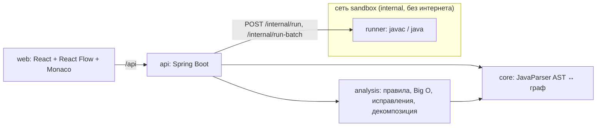
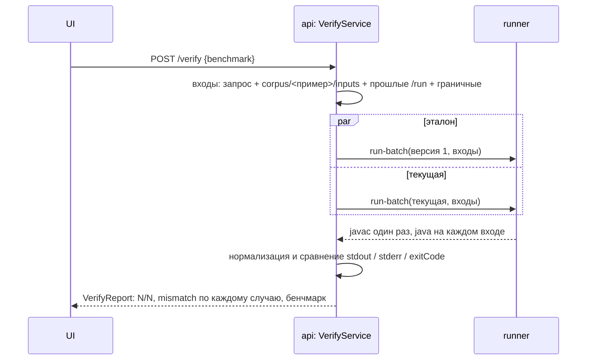

# Архитектура

| Модуль | Что делает | Зависимости |
|---|---|---|
| `backend/core` | Разбор Java в AST с сохранением форматирования, печать кода, обзорный граф и блок-схема метода, операции над графом (= операции над AST), обвязка для фаззинга | JavaParser, SymbolSolver; без Spring |
| `backend/analysis` | 10 правил дефектов, метрики (цикломатика, вложенность, Big O), 4 авто-исправления, предложение декомпозиции | `core`; без Spring |
| `backend/runner` | Песочница: компиляция и запуск пользовательского кода в отдельном контейнере | Spring Boot (web) |
| `backend/api` | REST API (`contracts/openapi.yaml`), проекты и версии в памяти, verify, quality gate, экспорт | `core`, `analysis`, HTTP-клиент к `runner` |
| `frontend` | Дерево проекта, холст графа, Monaco, панели «Проблемы» / «Консоль» / «Результат тестов» | React, React Flow, elkjs, Monaco |

Контракты между модулями — `contracts/graph.schema.json` (граф) и `contracts/openapi.yaml` (REST).

## Принципы

1. **AST — источник истины, граф — его проекция.** Правка кода → перепарсинг → новый граф. Правка на графе →
   операция над AST → печать кода → новый граф. Двух моделей, которые нужно синхронизировать, нет, поэтому код
   и граф не расходятся по построению.
2. **Форматирование сохраняется.** `LexicalPreservingPrinter` печатает нетронутый код байт-в-байт, операции графа
   правят текст строго в границах своих AST-узлов. Дифф для пользователя показывает только реальные изменения.
3. **Пользовательский код исполняется только в `runner`**, никогда в процессе `api`.
4. **Любое изменение кода от инструмента проходит quality gate:** новая версия компилируется и на тех же входах
   ведёт себя как предыдущая. Иначе изменение не применяется.
5. **Неподдерживаемая конструкция не роняет разбор:** она становится узлом `raw` («код как есть»).

## Поток данных

1. **Загрузка.** `POST /projects` → `JavaProjectParser` строит AST. Это версия 1 — эталон поведения для всех проверок.
2. **Граф.** `GET /graph?level=overview` — классы, методы, поля и рёбра вызовов (SymbolSolver, при сбое — откат на
   имя и число аргументов). `GET /graph?level=method&method=<id>` — блок-схема: переменная, условие (Да/Нет),
   цикл, вызов, операция, возврат, switch/case, break/continue, try/catch/finally, throw. Каждый узел хранит `astId`
   и диапазон строк: отсюда подсветка «узел ↔ строка» в обе стороны. Id узла — `"g" + astId`, на этом держится
   привязка находок к узлам.
3. **Правка.** Код в редакторе → `PUT /source`. На графе → `POST /graph/ops`: `editNode`, `insertAfter`, `delete`,
   `move`, `wrapIf`, `wrapLoop`, `extractMethod`. Каждая правка — новая версия проекта (оптимистичная блокировка
   по номеру версии, 409 при конфликте).
4. **Диагностика.** `GET /diagnostics` → `Analyzer`: находка = файл и строки + `nodeIds` в графе + объяснение +
   сложность «до / после» + вариант исправления + ожидаемый эффект; метрики по каждому методу.
5. **Исправление.** `POST /fixes/{findingId}` → `FixEngine` правит AST копии → **quality gate** → новая версия.
   Ответ: состояние, unified diff, описание и отчёт gate.
6. **Декомпозиция.** `POST /decompose` → `Decomposer` предлагает разбиение god-класса на `Parser` / `Analyzer` /
   `Optimizer` / `Main` / `Utils` с методами и полями (v1 — предложение без автоприменения).
7. **Запуск.** `POST /run` → `runner` → stdout, stderr, код выхода, время. Введённый stdin запоминается
   и становится дифф-тестом.
8. **Проверка.** `POST /verify` — дифференциальное тестирование версии 1 против текущей (ниже).
9. **Экспорт.** `GET /export` — zip: Maven-проект с текущей версией, исходной версией, диффом и golden-master
   тестами JUnit 5, а также отчётом проверки.

## Проверка поведения (`/verify`, quality gate, экспорт)

- **Входы.** Из запроса; из `corpus/<пример>/inputs/*.txt`, если загружен пример корпуса (сопоставление по содержимому
  файлов); stdin прошлых `/run`; шесть граничных (пустой ввод, пустая строка, 0, −1, `Integer.MAX_VALUE`, не число).
  Повторы убираются, максимум 40. Граничный вход, на котором эталон сам не уложился в таймаут, пропускается.
- **`run-batch`.** Компиляция один раз на версию, затем `java` на каждом входе. Версии прогоняются параллельно;
  с бенчмарком — последовательно, чтобы процессы не делили процессор.
- **Нормализация** (чтобы не было ложных расхождений): `\r\n` → `\n`; identity-хеши `Order@1b6d3586` → `Order@HASH`;
  пути временных папок песочницы; строки `Picked up JAVA_TOOL_OPTIONS`. В stderr не сравниваются кадры стектрейса
  (номера строк меняются после рефакторинга): сравниваются тип и сообщение исключения, `Caused by` и всё, что
  программа печатала сама.
- **Результат.** По каждому случаю — ожидаемый и фактический `RunResult` и `mismatch` вида «stdout: строка 1:
  ожидалось «…», получено «…»; exitCode: ожидался 0, получен 1». Если текущая версия не компилируется —
  `compiled=false`, если не компилируется эталон — 422.
- **Бенчмарк.** `benchmark=true` → входы `benchmarkInputs` или `corpus/<пример>/inputs/bench-<n>.txt` (n, 2n, 4n).
  Время эталона и текущей версии на каждом n; на этих входах тоже сравнивается вывод.
- **Quality gate.** Тот же механизм, но сравниваются *предыдущая* версия и *предложенная* (после авто-исправления).
  Gate уже поймал некорректное исправление: for-each вместо `LinkedList.get(i)` в цикле, который начинается не
  с 0, менял вывод — исправление отклонено, сессия не изменилась.
- **Экспорт.** Эталонные выводы версии 1 сохраняются в `golden/NN.*`. Сгенерированный `GoldenMasterTest` (JUnit 5)
  запускает текущую версию отдельным процессом и сравнивает вывод с той же нормализацией. Команда `mvn test`
  в архиве воспроизводит проверку без нашего инструмента.

## Песочница `runner`

| Мера | Как |
|---|---|
| Нет сети | сеть `sandbox` в compose с `internal: true`; `runner` доступен только из `api`, наружу не ходит |
| Файловая система | `read_only: true`, запись только в `tmpfs /tmp` (512 МБ); у каждого запуска своя временная папка, после запуска удаляется |
| Ресурсы | `mem_limit: 1g`, `cpus: 2`, `pids_limit: 256`; JVM пользователя с `-Xmx256m` |
| Привилегии | непривилегированный пользователь, `cap_drop: ALL`, `no-new-privileges` |
| Время и вывод | таймаут на запуск (по умолчанию 10 с, максимум 60 с) с уничтожением дерева процессов; вывод читается не больше 1 МБ |
| Входные данные | пути файлов не выходят за временную папку; `mainClass` — только FQN-идентификатор (защита от подстановки опций JVM); не больше 100 входов в пакете |
| Шум окружения | `JAVA_TOOL_OPTIONS` и родственные переменные не передаются в процесс пользователя |

## Тесты

| Модуль | Что проверяют |
|---|---|
| `core` | round-trip на всём корпусе и `ScopeSample.java` (разбор, печать байт-в-байт, согласованность графов), блок-схемы, граф вызовов, все операции графа — результат каждой компилируется `javac` |
| `analysis` | каждое правило, метрики и Big O, авто-исправления (компилируются, отказ в небезопасных случаях), декомпозиция, монолит на 1000 строк, привязка находок к узлам, весь корпус |
| `runner` | компиляция и запуск, кириллица, таймаут, `run-batch`, лимит вывода, защита путей и `mainClass`; весь корпус компилируется, и каждый вход даёт детерминированный вывод |
| `api` | REST-сценарии, нормализация, логика verify, quality gate (пропускает и отклоняет), unified diff, экспорт (сгенерированный JUnit-тест компилируется) |

CI (`.github/workflows/ci.yml`): `mvn -B verify`, сборка фронта, lint OpenAPI-контракта, `docker compose build`.

## Ограничения

- **Состояние в памяти.** Проекты и версии живут в памяти `api` (решение D8) и после перезапуска пропадают.
- **Один `main` и stdin.** Поведение проверяется через запуск `main` с stdin. Методы без консольного ввода
  проверяются, только если их вызывает `main`. Фаззинг статических методов через сгенерированную обвязку
  (`core/fuzz/FuzzHarness`) в verify пока не подключён.
- **Недетерминированные программы.** Программа, вывод которой зависит от времени, `Random` без seed, порядка
  `HashMap` с ключами-объектами без `hashCode` или от потоков, даст расхождения даже без изменений: verify честно
  покажет их как «поведение изменилось».
- **Граф.** Не показываются `static`-блоки инициализации, компоненты record и компактный конструктор, константы
  enum (код сохраняется и правится в редакторе). Switch-выражения, лямбды и Stream-цепочки видны в коде блока,
  но не раскрываются в подграф. `synchronized`, локальные классы и records внутри метода — узел `raw`.
- **Авто-исправления.** Четыре детерминированных переписывания AST. Остальные находки (вложенные циклы,
  дублирование, длинные методы) содержат объяснение и вариант исправления, но правятся вручную или операциями
  графа (`extractMethod`).
- **Декомпозиция** — только предложение разбиения, без автоматического переноса кода между классами (G7).
- **Бенчмарк** измеряет время всего процесса, включая старт JVM (~0,1–0,3 с), поэтому разница видна только на
  входах, где алгоритм работает дольше старта, — для этого в корпусе есть `bench-<n>.txt`.
- **Вне scope кейса:** многопоточность, рефлексия, файлы, сеть, `java.time`. Такой код разбирается и правится,
  но в песочнице нет сети и записи на диск вне `/tmp`.

Подробная матрица поддержки конструкций — [`docs/scope.md`](scope.md).
