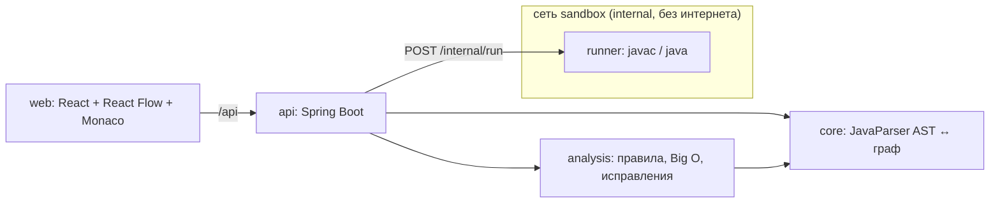

# Архитектура

## Поток данных

1. **Загрузка.** `POST /api/projects` → `JavaProjectParser` строит AST (с сохранением форматирования). Это версия 1 —
   эталон поведения.
2. **Граф.** `GraphBuilder` проецирует AST в граф (`contracts/graph.schema.json`): обзор (классы, методы, вызовы)
   или блок-схема метода. Каждый узел хранит `astId` и диапазон строк — отсюда двусторонняя подсветка.
3. **Правка.** Код в редакторе → `PUT /source` → перепарсинг. Правка на графе → `POST /graph/ops` → операция над AST →
   `CodeGenerator` печатает код → новая версия. Источник истины всегда AST, поэтому код и граф не расходятся.
4. **Диагностика.** `Analyzer` прогоняет правила (`Rule`) по AST: находка = строка + узлы графа + объяснение +
   сложность + исправление.
5. **Улучшение.** Исправление / декомпозиция = переписывание AST → новая версия.
6. **Проверка.** `POST /verify`: версия 1 и текущая компилируются и запускаются в `runner` на одинаковых входах,
   сравниваются stdout, stderr и код выхода; опционально бенчмарк на растущих входах.

## Изоляция пользовательского кода

`runner` — отдельный контейнер: внутренняя сеть без выхода наружу, read-only файловая система (запись только в tmpfs
`/tmp`), лимиты памяти/CPU/процессов, без capabilities, непривилегированный пользователь, таймаут и лимит вывода
на каждый запуск.

## Поддержанный scope Java

Обязательные разделы 1–4 (язык и `java.lang`, консольный ввод-вывод, коллекции, исключения) и бонус (record, enum,
дженерики, лямбды и `java.util.function`, Stream API и Collectors) покрыты корпусом из шести монолитов. Каждый пример
корпуса автоматически проходит четыре уровня проверки: разбор и печать байт-в-байт, обзор и блок-схема каждого метода,
правка через граф, компиляция и запуск в песочнице с детерминированным выводом.

Матрица «конструкция → как выглядит на графе → в каком примере проверена»: [scope.md](scope.md).

## Ограничения

- **Визуализация отдельных конструкций.** Блоки инициализации `static {}`, компактный конструктор record, тела
  констант enum и методы анонимных классов не показаны на обзоре отдельными узлами. Тела лямбд и цепочки Stream
  видны кодом внутри блока, без своей схемы. Код при этом сохраняется, выполняется и проверяется дифф-тестами.
  Список с примерами — [scope.md](scope.md#пробелы-что-видно-хуже-чем-остальное).
- **Неподдержанный оператор** (`synchronized`, локальный класс или record) становится блоком «Код как есть» (`raw`).
  Разбор не падает.
- **Проверка поведения — по входам.** Дифф-тесты сравнивают stdout, stderr и код выхода версии 1 и текущей на
  входах корпуса, входах прошлых запусков и граничных входах (не больше 40). Различие на входе, которого нет в
  наборе, не будет найдено. Кадры стектрейса и адреса объектов (`@hex`) не сравниваются.
- **Песочница:** нет сети, файловая система только для чтения (запись — только во временный `/tmp`), лимиты
  времени, памяти и вывода. Программы с файлами, сетью или потоками (вне scope кейса) могут вести себя иначе,
  чем локально.
- **Декомпозиция** пока только предлагает разбиение на классы (`POST /decompose`, `apply=false`), сама код не
  переписывает.
